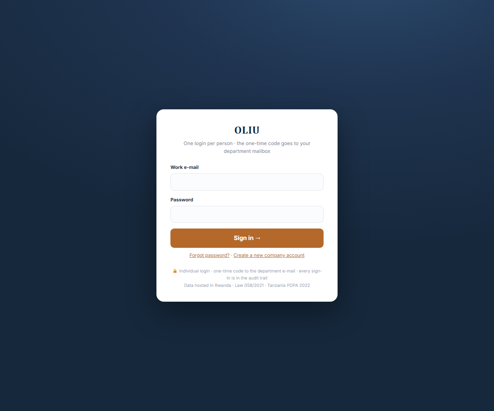
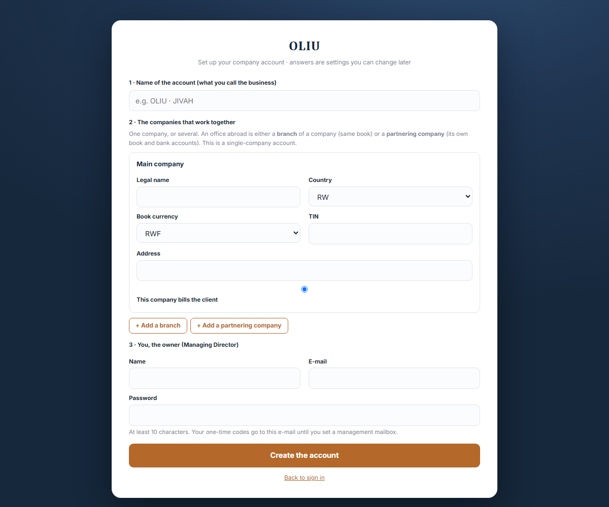
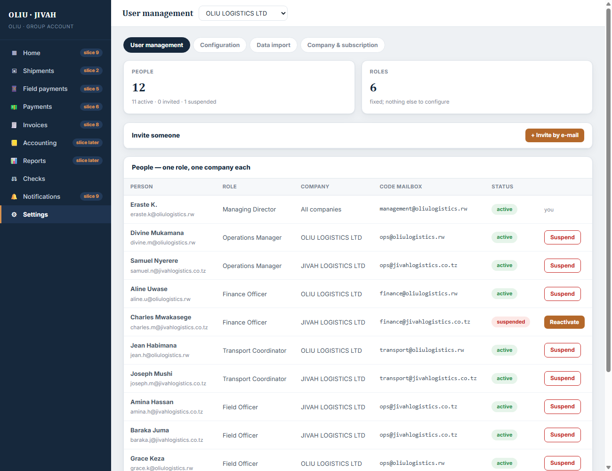
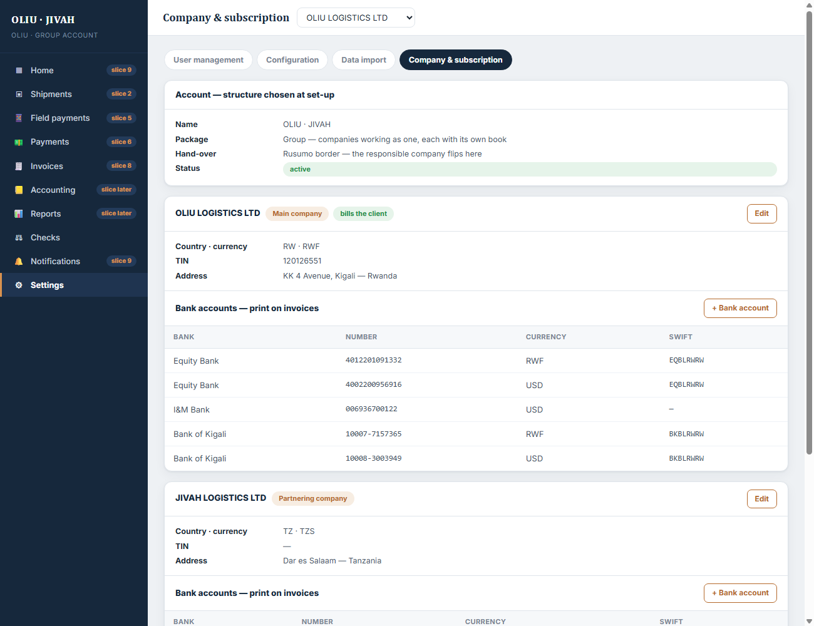
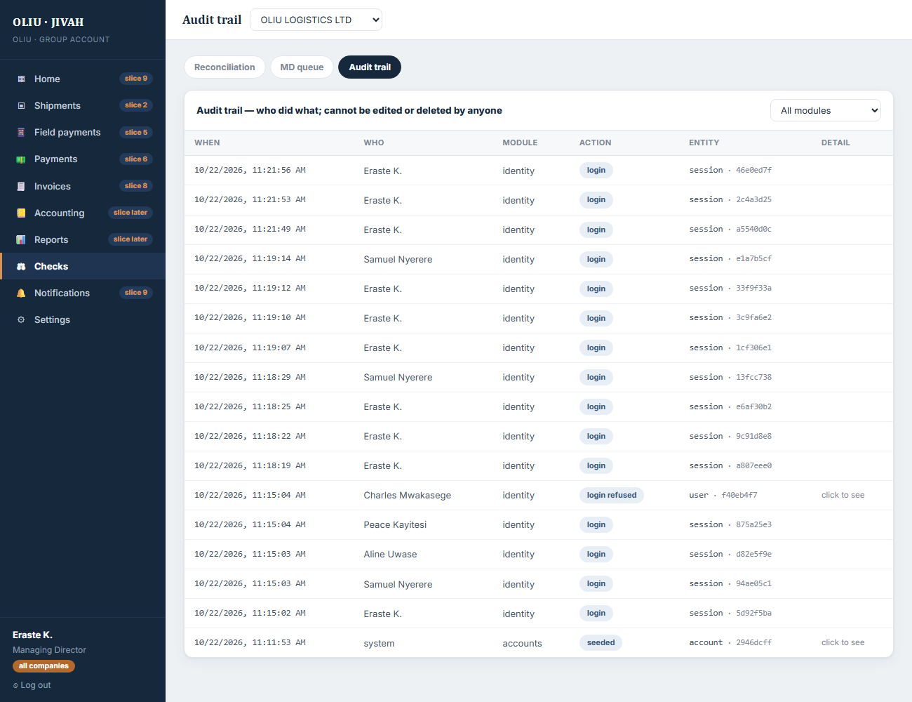
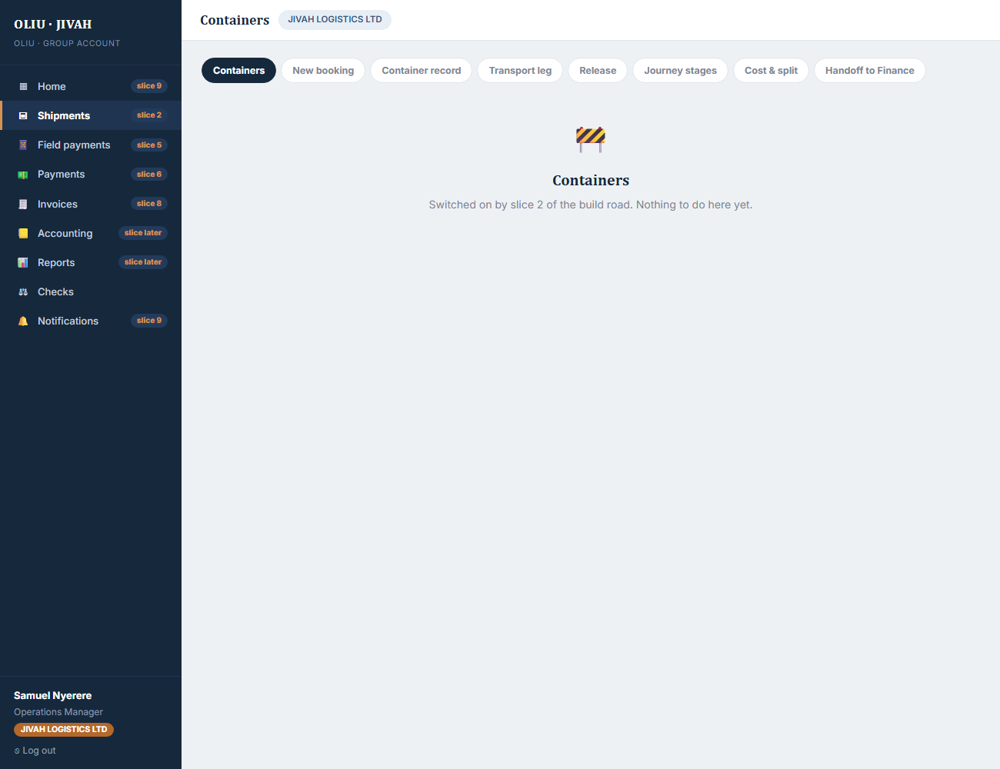

# Slice 1 — Accounts, companies, roles

**Built:** 22 October 2026 · **Status:** code complete, 12 automated tests passing, waiting for your live test.
**Roadmap:** slice 1 of 12, the spine. Nothing else exists yet, on purpose.

This note is written for you, not for a developer. It says what exists, how it works, how to try it,
what was tested, what was left out, and the questions for you.

---

## 1. What exists now, in one picture

```
 browser (Nuxt, port 3000)  ──/api/*──▶  API (Express, port 3001)  ──▶  PostgreSQL
   login · one-time code                 checks who you are and             Account
   set-up questions                      what you may touch on              Company · BankAccount
   Settings → User management            EVERY request                      User · Session · OtpChallenge · ActionToken
   Settings → Company & subscription                                        FeatureSwitch
   Checks → Audit trail                                                     AuditEvent (append-only)
```

Three screens work. Every other menu is there, in the right place, and says which slice brings it.

| | |
|---|---|
|  |  |
|  |  |
|  |  |

## 2. The rules this slice makes true

| Rule | Where it lives | How you can see it |
|---|---|---|
| One login per person, one role, in one company or all | `User` table: `role`, `companyId` (null = all) | User management: each person's row |
| The one-time code goes to a **department mailbox**, not a personal inbox | `User.otpMailbox` | Login step 2 names the mailbox |
| A person sees only their company's side | `middleware/auth.ts` builds a *scope* from the session; every query filters by it | Sign in as Samuel (JIVAH): only JIVAH in the switcher, no OLIU anywhere |
| The owner sees across all companies | MD and Reporting Officer have `companyId = null` | Sign in as Eraste: switcher with OLIU and JIVAH |
| A suspended person is refused and the attempt is kept | `identity/routes.ts` login → `login_refused` audit row | Try Charles Mwakasege |
| History cannot be edited or deleted, by anyone | a database trigger on `AuditEvent` refuses UPDATE and DELETE | Test "the audit table refuses UPDATE and DELETE" |
| The browser is never trusted | the web app only displays what `/api/auth/me` returns; menus, permissions and company lists come from the API | Change nothing in the browser, the API still decides |

## 3. How a request travels through the code

Take "Aline, Finance Officer at OLIU, opens User management".

1. The browser calls `GET /api/users` with the session cookie. Nuxt proxies it to the API.
2. `attachSession` (api/src/middleware/auth.ts) reads the cookie, checks its signature, loads the
   session and the user. It builds a **Scope**: `{ accountId, userId, role: FINANCE_OFFICER, companyId: OLIU }`.
3. The route (api/src/modules/accounts/routes.ts) asks `requireAuth`, then queries users
   `where accountId = scope.accountId and (companyId = OLIU or companyId = null)`. The filter comes
   from the scope, never from anything Aline typed.
4. The answer is a list of OLIU people and the all-company people. JIVAH's staff are not in it.

Take "Eraste invites Charles as JIVAH Finance Officer".

1. `POST /api/users` with name, e-mail, role, company. `requirePermission('users')`: only the MD passes.
2. The route checks the company belongs to the account and that the role needs a company.
3. In one transaction: the user row is created with status `INVITED`, an audit row `user_invited` is written.
4. A one-use link is e-mailed (in development it lands in `http://localhost:3001/dev/mail`).
5. Charles opens the link, chooses a password, becomes `ACTIVE`. Audit row `password_set`.

## 4. Folders, so you can find things

```
shared/src/index.ts           the vocabulary: six roles, their permissions and screens, packages, stages,
                              the set-up questions (validation rules), company kinds
api/src/config.ts             reads .env once, refuses to start if something is missing
api/src/db.ts                 the database client and the scope helpers (byAccount, byCompany)
api/src/middleware/auth.ts    who is calling; requireAuth / requireRole / requirePermission
api/src/lib/                  audit, crypto (hashing, signing), mail, errors, validation
api/src/modules/identity/     login, one-time code, logout, me, set-password, forgot
api/src/modules/accounts/     create account, companies, bank accounts, people
api/src/modules/audit/        read the trail
api/src/modules/dev/          development inbox (never in production)
api/prisma/schema.prisma      the tables; migrations/ holds the SQL that created them
api/prisma/seed.ts            the OLIU · JIVAH demo account with twelve people
api/test/slice1.test.ts       the roadmap's tests as code
web/pages/                    login, setup, set-password, forgot, app/[screen]
web/components/Screen*.vue    the three built screens
web/layouts/app.vue           the sidebar built from what the API says the role may open
```

## 5. Try it yourself

```
npm run db:start      (keep this window open)
npm run db:migrate
npm run db:seed
npm run dev:api       (second window)
npm run dev:web       (third window)
```

Open http://localhost:3000. Password for every demo person: `Oliu-demo-2026`.
The six-digit code is at http://localhost:3001/dev/mail (nothing leaves your machine in development).

| Sign in as | E-mail | What you should see |
|---|---|---|
| Eraste K., MD | eraste.k@oliulogistics.rw | all ten menus, the switcher with OLIU and JIVAH, 12 people, the audit trail |
| Samuel Nyerere, Ops Manager JIVAH | samuel.n@jivahlogistics.co.tz | nine menus, no switcher, JIVAH only |
| Aline Uwase, Finance Officer OLIU | aline.u@oliulogistics.rw | Home, Payments, Invoices, Accounting, Reports, Notifications |
| Peace Kayitesi, Field Officer | peace.k@oliulogistics.rw | Shipments, Field payments, Notifications; cannot open the audit trail |
| Claire Irakoze, Reporting Officer | claire.i@oliulogistics.rw | read-only banner; audit trail readable |
| Charles Mwakasege | charles.m@jivahlogistics.co.tz | refused: suspended. Reactivate him as Eraste, then he can sign in |

Then as Eraste: invite someone, open the dev inbox, follow the link, set a password, sign in as them.
Try `/setup` to create a second, single-company account: it will have one company and no switcher.

## 6. What was tested, and how

Twelve automated tests run against a fresh database on every `npm test` (about 8 seconds):

- Account set-up creates main, partner and branch companies and the owner as MD; refuses a group with
  no partner, two billers, or a branch without a parent.
- Login mails a six-digit code to the department mailbox; a wrong code is refused; a forged cookie is refused;
  a wrong password and an unknown e-mail get the same answer (nothing to learn from the difference).
- A JIVAH Finance Officer never sees the OLIU company, even when asking for it by name; the MD sees every company.
- The switcher accepts only a company of the same account (another account's company: 403).
- A Finance Officer cannot invite; the MD can; a company-bound role must be given a company.
- A single-company account has one company and no partner.
- Suspension: the session dies, the next login is refused, the refusal is in the trail, the MD can reactivate.
- The audit table refuses UPDATE and DELETE at database level.
- A Field Officer cannot read the trail; a Reporting Officer can, with no write permissions.

Also done by hand through the running web app: the six logins above, the switcher guard, the people list,
the audit trail, the dev inbox.

Security checklist for this slice: passwords hashed with argon2id · codes and link tokens stored only as
hashes · session cookie httpOnly, signed, SameSite · rate limits on login, code and set-up · every input
validated with a schema · every query parameterised by Prisma · secrets only in `.env` · helmet headers ·
errors never leak internals · dependencies pinned.

## 7. What was deliberately left out

- No bookings, containers, money. Slice 2 starts the container.
- No four-eyes on bank account changes yet (the fields exist; the rule arrives with Payments, slice 6).
- Feature switches are stored but have no screen; they get one in the owner portal.
- No owner portal: the account is created from `/setup`, which is the same set-up form the tenant keeps.
- Nothing is sent by real e-mail or SMS yet; development keeps mail on the machine. Production needs an SMTP account.

## 8. Two things that changed on the way

- **Docker is not installed on this machine, and the application-control policy blocks native PostgreSQL
  binaries.** Development therefore runs PGlite: real PostgreSQL compiled to WebAssembly, served on a port
  so Prisma talks to it normally. The server will use ordinary PostgreSQL from `docker-compose.yml`; nothing
  in the code knows the difference. Hosting in Kigali is unchanged.
- A force-killed API can leave the local database holding a dead connection. The database script now keeps
  running through that; if it ever looks stuck, stop it with Ctrl+C and run `npm run db:start` again.

## 9. Questions for you

1. The **department mailboxes** (management@, ops@, finance@, transport@, reports@ for OLIU; the same for JIVAH)
   must exist before slice 1 can be tested with real e-mail. Who creates them, and by when?
2. The Reporting Officer is **all-company** in the old mockup. Keep that, or make it a per-company role too?
3. The demo seed names people from the mockup. Give me the **real list of twelve** (name, e-mail, role, company)
   when you have it and the seed becomes the real first load.
