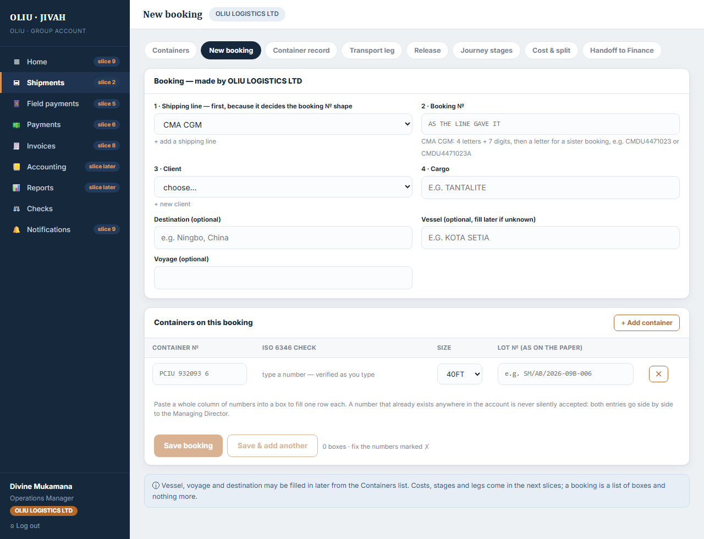
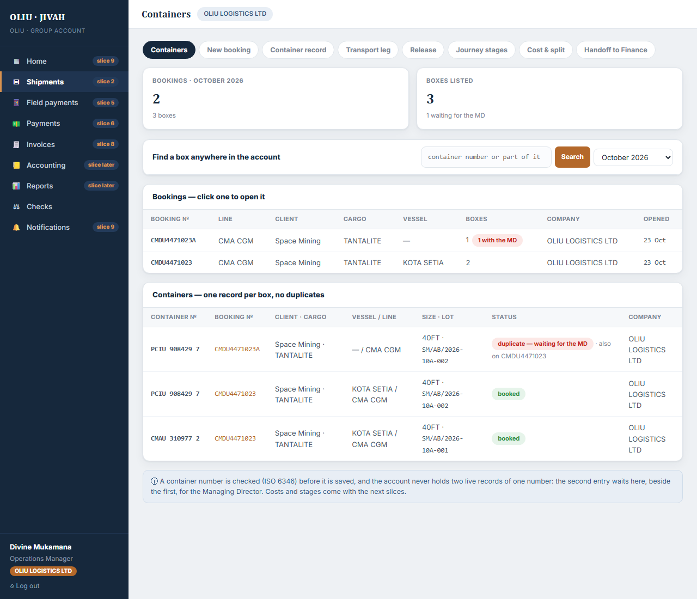
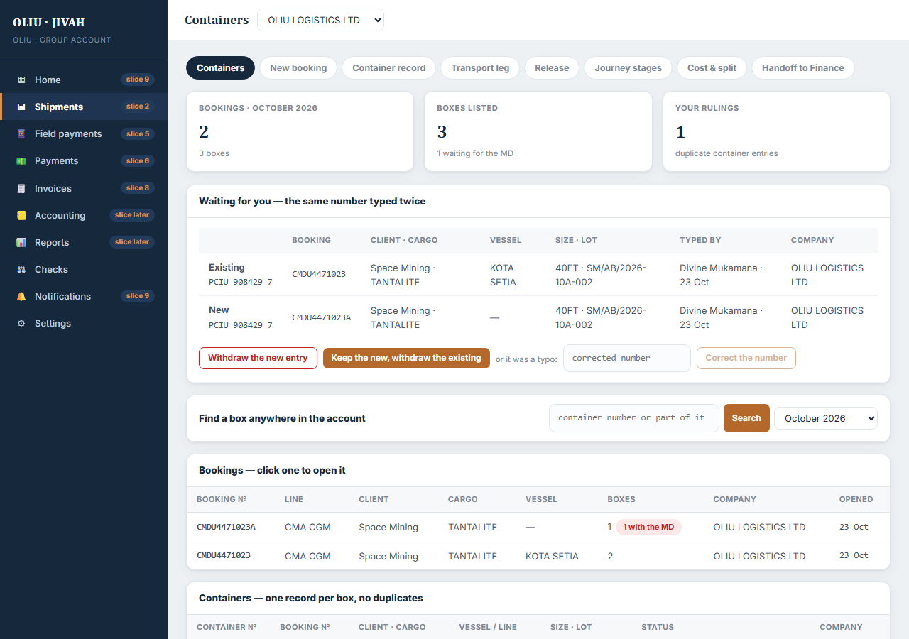
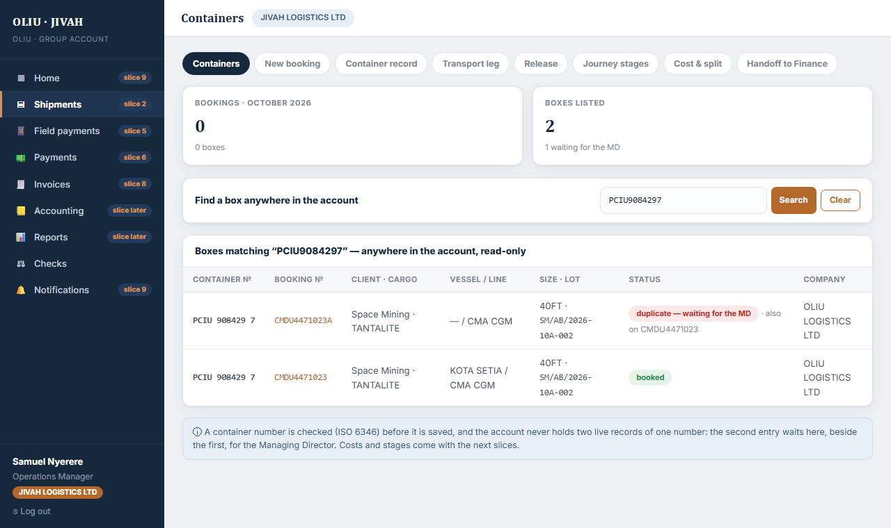

# Slice 2 — Booking and container

**Built:** 23 October 2026 · **Status:** code complete, 22 automated tests passing (8 new), waiting for your live test.
**Roadmap:** slice 2 of 12, the spine. A booking is a list of boxes and nothing more. No costs, no stages, no legs.

This note is written for you, not for a developer. It says what exists, how it works, how to try it,
what was tested, what was left out, and the questions for you.

---

## 1. What exists now, in one picture

```
 browser (Nuxt, port 3000)             API (Express, port 3001)             PostgreSQL
   Shipments → New booking    ──/api/*──▶  checks the number (ISO 6346),  ──▶  ShippingLine · Client
   Shippings → Containers                  the booking № shape, and who         Booking · Container
     list · search by number               may write, on EVERY request         MdQueueItem (duplicates)
     booking detail · fill later                                              AuditEvent (append-only)
     MD: duplicates side by side
```

Two screens are new. The rest of the Shipments menu still says which slice brings it.

| | |
|---|---|
|  |  |
|  |  |

## 2. The rules this slice makes true

| Rule | Where it lives | How you can see it |
|---|---|---|
| A container number is checked before it is saved: four letters, six digits, one check digit (ISO 6346) | `shared/src/index.ts` → `checkContainerNumber`; the form uses it as you type, the API refuses a bad one | Type `PCIU9320935`: the field says "Check digit should be 6, not 5" and Save stays off |
| The account never holds two live records of one number | a database index that allows one ACTIVE record per number per account; a second entry is saved as DUPLICATE beside it | Enter a box that exists: both entries appear on the Containers screen, and in the MD's "Waiting for you" panel |
| Only the Managing Director rules on a duplicate | `POST /api/md-queue/:id/resolve` needs the `reconcile` permission, which only the MD holds | Divine sees the duplicate but no buttons; Eraste has three: withdraw the new, keep the new, correct the number |
| The person who makes the booking adds its boxes | writing needs the `book` screen and the `write` permission: MD and Operations Manager | Aline (Finance) has no Shipments menu; `/app/book` says the screen is not visible to her role |
| A booking belongs to the company that made it; the other side can read it, never change it | `mayTouchCompany` on every write; `mayEdit` in the booking detail | Samuel (JIVAH) finds an OLIU box by number, opens its booking, sees no edit form |
| The shipping line decides the booking № shape; its usual owner codes only produce a note | `ShippingLine.referencePattern` is enforced; `usualPrefixes` is advice | CMA CGM refuses `ABC123` and says "4 letters + 7 digits"; a `FFAU` box on PIL saves with a note |
| The browser never decides | menus, `mayEdit`, the duplicate ruling, the number check: all answered by the API | Change nothing in the browser, the API still decides |

## 3. How a request travels through the code

Take "Divine, Operations Manager at OLIU, saves booking DAR600233400 with twelve boxes".

1. The browser has already said ✓ next to each number, using the same `checkContainerNumber` the API uses.
   It calls `POST /api/bookings` with the line, the booking №, the client, the cargo, the vessel and the twelve boxes.
2. `attachSession` builds the Scope: `{ accountId, userId, role: OPS_MANAGER, companyId: OLIU }`.
3. The route (api/src/modules/shipments/routes.ts) asks `requireScreen('book')` and `requirePermission('write')`.
   It checks every number again, checks the booking № against the line's shape, and that the № is new.
4. In one transaction: the booking row is written for company OLIU, then each box. For each box the route looks
   for a live record of that number in the account. None: the box is ACTIVE. One found: the box is saved as
   DUPLICATE, pointing at its twin, and an MD-queue item is opened. Every step is an audit row.
5. The answer lists the boxes, the duplicates (with the booking they already sit on) and the notes.

Take "Samuel, Operations Manager at JIVAH, looks up PCIU 932093 6".

1. `GET /api/containers?q=PCIU9320936`. Scope: `{ role: OPS_MANAGER, companyId: JIVAH }`.
2. Without `q` the route lists only JIVAH's bookings — none yet. With `q` it searches the whole account, because
   the box is the unit of truth and JIVAH will handle it after the hand-over.
3. The row comes back with its booking №, client, vessel, line and the company that made the booking.
   Opening the booking returns `mayEdit: false`; a PATCH or an added box from Samuel is refused with 403.

Take "Eraste rules on the duplicate".

1. `GET /api/md-queue` returns each open case with both entries: number, booking, client, cargo, size, lot,
   who typed it and when, and which company.
2. `POST /api/md-queue/:id/resolve` with `WITHDRAW_NEW`, `KEEP_NEW` or `CORRECT_NUMBER` + the number. One
   transaction changes the statuses, closes the case and writes `duplicate_resolved` to the trail.

## 4. Folders, so you can find things

```
shared/src/index.ts                  checkContainerNumber (ISO 6346), sizes, the booking / container / line /
                                     client / resolution inputs — one rule, read by the API and the web app
api/src/modules/shipments/           routes.ts and README.md — everything of this slice on the API side
api/src/middleware/auth.ts           requireScreen: a route belongs to a screen; only roles that open it may call it
api/prisma/schema.prisma             ShippingLine, Client, Booking, Container, MdQueueItem
api/prisma/migrations/20261023000000_slice2_booking_container/   the SQL, with the one-live-record index at the end
api/prisma/seed.ts                   five shipping lines and the two clients of the October invoices
api/test/slice2.test.ts              the roadmap's runs as code
web/components/ScreenBooking.vue     Shipments → New booking
web/components/ScreenContainers.vue  Shipments → Containers: list, search, booking detail, the MD's panel
```

## 5. Try it yourself

```
npm run db:start      (or the window titled "OLIU db:start" if it is still open)
npm run db:migrate
npm run db:seed       adds the shipping lines and the two clients; people untouched
npm run dev:api
npm run dev:web
```

Password for every demo person: `demo`. Codes land in http://localhost:3001/dev/mail.

| Sign in as | E-mail | Role in this slice |
|---|---|---|
| Divine Mukamana | divine.m@oliulogistics.rw | Operations Manager, OLIU: makes the bookings |
| Eraste K. | eraste.k@oliulogistics.rw | MD: rules on duplicates; can also book, for the company in the switcher |
| Samuel Nyerere | samuel.n@jivahlogistics.co.tz | Operations Manager, JIVAH: the other side |
| Aline Uwase | aline.u@oliulogistics.rw | Finance Officer: no Shipments menu |

## 6. Your test road — seven runs, tick each one

The two October invoices give the eighteen boxes. The invoices print the BL №, not the shipping line's booking №;
use the BL № as the booking № for the test (question 1 below). Size is not on the Transvera invoice: use 40FT.
Paste a column of numbers into the first container box and the form fills one row per number.

| # | Run | Sign in as | What must happen | ✓ |
|---|---|---|---|---|
| 1 | Space Mining | Divine | Shipments → New booking · line PIL · booking № `DAR600233400` · client Space Mining · cargo TANTALITE · vessel KOTA SETIA · the 12 boxes below with their lot numbers · every row shows ✓ · Save → "saved with 12 boxes" | ☐ |
| 2 | Transvera | Divine | booking № `DAR600210600` · client Transvera · the 6 boxes below · Save → 6 boxes · Containers list now shows 18 boxes and 2 bookings, this month | ☐ |
| 3 | A wrong digit | Divine | New booking, type `PCIU9320935` · the row says "Check digit should be 6, not 5" · Save stays off until you fix it | ☐ |
| 4 | A duplicate | Divine, then Eraste | New booking `DAR600241900`, box `FFAU8028326` (already on run 1) · it saves and says both entries went to the MD · as Eraste, Containers shows "Waiting for you" with both entries side by side · rule "Withdraw the new entry" · the row on DAR600241900 shows "withdrawn" | ☐ |
| 5 | The other side | Samuel | Containers: "No bookings this month on your side" · search `PCIU9320936` → found, with booking DAR600233400, Space Mining, KOTA SETIA, made by OLIU · click the booking № → read-only, no edit form | ☐ |
| 6 | Fill later | Divine | Containers → click DAR600233400 · voyage and destination · Save these details · add a box `PCIU9084297` → "Box added" · the audit trail shows booking updated and container added | ☐ |
| 7 | Not for Finance | Aline | no Shipments menu · typing `/app/book` in the address bar says the screen is not visible to your role | ☐ |

Pass when eighteen real containers are in the system with no retyping, one wrong digit was caught, one duplicate
reached the MD with both records shown, and nothing looked wrong, slow or confusing, wording included.

**Space Mining, KOTA SETIA, 40FT — box and lot №**

```
FFAU8028326   SM/AB/2026-09B-006        PIDU4544108   SM/AB/2026-09B-012
PCIU9320936   SM/AB/2026-09B-007        FFAU8024608   SM/AB/2026-09B-013
PCIU8878266   SM/AB/2026-09B-005        PCIU9040977   SM/AB/2026-09B-014
GLDU9067500   SM/AB/2026-09B-009        PCIU9154223   SM/AB/2026-09B-015
HPCU4743967   SM/AB/2026-09B-011        HPCU5173344   SM/AB/2026-09B-016
GAOU7500478   SM/AB/2026-09B-008
GCXU5105809   SM/AB/2026-09B-010
```

**Transvera, KOTA SETIA, 40FT assumed — box and lot №**

```
PCIU0016178   SFN/LIS/002/RH/SEP-26     PIDU2026877   SFN/LIS/003/RH/SEP-26
PCIU1809371   SFN/LIS/001/RH/SEP-26     PCIU2892210   SFN/LIS/006/RH/SEP-26
PCIU1619134   SFN/LIS/004/RH/SEP-26     GCXU5178913   SFN/LIS/005/RH/SEP-26
```

## 7. What was tested, and how

Twenty-two automated tests run against a fresh database on every `npm test` (about 15 seconds); eight are new:

- The eighteen real numbers of the two invoices pass the check; `pciu 932093-6` is read as `PCIU9320936`.
- A wrong check digit is refused with the digit it should be; a wrong shape and a wrong fourth letter are refused.
- The two invoices enter as two bookings with eighteen ACTIVE boxes, lot numbers kept; the bookings list counts them.
- The API refuses a wrong digit even if the browser did not, and saves nothing of that booking.
- A number that exists is saved as a duplicate beside its twin; exactly one live record per number remains; the
  Operations Manager cannot rule; the MD sees both sides and each of the three rulings does what it says; a ruling
  cannot be given twice; a correction to a number that is also taken is refused; the trail has every step.
- JIVAH's own list is empty, a search finds the OLIU box with its booking and client, read-only; the owner may
  fill the later fields and add boxes, and cannot add the same box twice.
- A line's booking № shape is enforced, its usual owner codes only produce a note, a line cannot be added twice
  under a different case, and an unusable pattern is refused.
- The MD books only for the company chosen in the switcher; a Finance Officer cannot book or add a client;
  another account sees none of it — not by search, not by id, not in the line list.

Also done by hand through the running web app: the two screens as Divine, Eraste and Samuel (the screenshots above),
the as-you-type check, the paste of several numbers, the duplicate warning before saving, the three rulings.

Security checklist for this slice: every query scoped by account, and by company where the record is company-bound ·
every input validated by the shared schema, numbers normalised before any comparison · the booking № pattern is typed
by the MD/Operations Manager and run only against a 40-character field · the one-live-record rule is enforced by the
database itself, not only by the code, so two people typing the same new number at the same moment cannot both win ·
nothing is deleted, a withdrawn box stays in the record · the MD-queue ruling needs the `reconcile` permission ·
dependencies unchanged.

## 8. What was deliberately left out

- No costs, no stages, no legs, no board view. The box's stage is BOOKED and stays so until slice 4.
- No screen of their own yet for shipping lines and clients: both are added from the booking form. Settings →
  Configuration (slice 3) will list them properly.
- The MD queue has no menu of its own yet: the duplicates panel lives at the top of the Containers screen for the MD.
  Checks → MD queue arrives with slice 6 and takes these cases over.
- No "move boxes to a sister booking" tool. A sister booking is typed as a new booking; the line patterns accept the
  letter suffix (CMDU4471023A).
- No booking-level draft/final documents, no per-container packet: the documents slice, later, by the person who
  makes the booking (your decision of 23 October).
- No Excel download.

## 9. Things that changed on the way

- **The mockup's sample numbers are not real container numbers.** TCLU 1234565 and MSKU 6011240 fail the ISO 6346
  check; all eighteen on your invoices pass it. The mockup will be corrected the next time it is touched.
- **Owner codes belong to leasing companies, not to the line.** FFAU, GLDU, HPCU, GAOU and GCXU boxes travel on PIL
  vessels in your own invoices. So a line's "usual codes" only produce a note, never a refusal.
- **Uniqueness is per account, not across all tenants.** The same leased box can legitimately appear in another
  company's system in another month. "Unique system-wide" on the roadmap means within your account.
- **Sister bookings.** The CMA CGM, Maersk and Hapag-Lloyd patterns accept one letter after the number.
- **The screenshots** came from a demo booking CMDU4471023 and its sister CMDU4471023A with one repeated box, removed
  afterwards so your test road starts clean. The audit trail keeps those rows, as it must.

## 10. Questions for you

1. **The booking №.** The invoices print PIL's BL numbers (DAR600233400 …), not booking numbers. What does PIL's
   booking confirmation number look like? Then PIL gets a shape too, and the hint under the field says it.
2. **Who owns the lists** of shipping lines and clients: the Operations Manager, as now, or only you?
3. **JIVAH's working list** is empty until the hand-over flip of slice 4; they find boxes by number meanwhile. Keep it
   that way, or should JIVAH see every box of the account from the day it is booked?
4. **Container size** is missing from the Transvera invoice. Is 40FT right?
5. The three questions of slice 1 are still open: the department mailboxes, the Reporting Officer's scope, the real
   list of twelve people.
